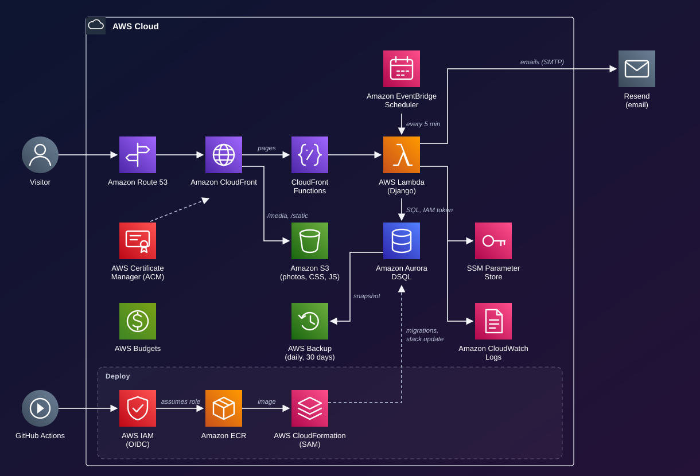

# Arcana Crochet

Online store for Arcana Crochet: handmade crochet pieces sold directly to customers. The code, docs and commits are in English; the store itself is in Brazilian Portuguese.

**Stack:** Django 6.1 · HTMX + Tailwind · AWS Lambda + CloudFront + S3 + Aurora DSQL (infrastructure in SAM, deployed by GitHub Actions with OIDC) · PostgreSQL and Docker Compose in development · Asaas (payments) · Melhor Envio (shipping).

The complete technical specification (data model, flows, security and LGPD) is in the project document on Claude.

## Architecture



Visitors reach CloudFront, which serves photos from S3 and sends everything else to Django on Lambda. Django stores its data in Aurora DSQL, a serverless PostgreSQL-compatible database it connects to with an IAM token instead of a password. AWS Backup snapshots the database daily. Details, services and costs: [docs/architecture.md](docs/architecture.md).

## Running it on your computer

Development uses a regular PostgreSQL; only production runs on Aurora DSQL.

### Option A — with Docker (recommended)

Requirement: [Docker Desktop](https://www.docker.com/products/docker-desktop/).

```bash
cp .env.example .env          # on Windows: copy .env.example .env
docker compose up --build     # starts the database and the site
```

In another terminal, create your admin user:

```bash
docker compose exec web python manage.py createsuperuser
```

- Store: http://localhost:8000
- Admin: http://localhost:8000/admin/
- Emails (sign-up confirmation, password) show up in the `docker compose` terminal.

### Option B — without Docker

Requirements: Python 3.13 and PostgreSQL running locally.

```bash
python -m venv .venv
source .venv/bin/activate        # on Windows: .venv\Scripts\activate
pip install -r requirements/dev.txt
cp .env.example .env             # adjust DATABASE_URL to your Postgres
# user and database expected by .env (run in psql as postgres):
#   CREATE USER arcana WITH PASSWORD 'arcana' CREATEDB; CREATE DATABASE arcana OWNER arcana;
python manage.py migrate
python manage.py createsuperuser
python manage.py popular_demo    # optional: demo pieces, orders and reviews
python manage.py runserver
```

## Everyday commands

| What | Command |
| --- | --- |
| Run the tests | `python -m pytest` |
| Check style | `ruff check .` and `ruff format .` |
| Create migrations | `python manage.py makemigrations` |
| Apply migrations | `python manage.py migrate` |
| Demo data | `python manage.py popular_demo` (customer: `cliente@arcana.test` / `arcana-demo-123`) |
| CSS (Tailwind) | `npm install` once, then `npm run watch:css` or `npm run build:css` |
| Check migrations against Aurora DSQL | `python manage.py ensaio_dsql \| dsql-lint -` (setup in [docs/deploy.md](docs/deploy.md#7-database-changes); CI runs it on every push) |

With Docker, prefix them with `docker compose exec web`, e.g. `docker compose exec web python -m pytest`.

## Layout

```
config/            Django settings, URLs, SSM secrets loading, Aurora DSQL engine
config/migracoes/  Django and allauth migrations rebuilt for Aurora DSQL
apps/core/         shared base: ModeloBase (UUID v7), prices (Pix and installments), search text, DSQL-safe transactions
apps/contas/       users with email login, customer/attendant/admin roles, addresses
apps/catalogo/     categories, products, variations, photos, spec sheet, stock, search and filters
apps/pedidos/      bag, shipping, coupons, checkout, orders and tracking
apps/avaliacoes/   reviews from customers who received the piece, with moderation
templates/         store pages (home, listing, product, bag, checkout, my account)
static/            compiled CSS, store JS, fonts and brand images
docker/            Dockerfile (the same for development and Lambda) and entrypoint
infra/             AWS: the store's SAM template, base stack (ECR + GitHub role) and secrets script
frontend/          Tailwind source (compiles to static/css/app.css)
docs/              architecture, deploy, frontend and external accounts guides
tests/             automated tests (pytest)
```

Python identifiers, models and URLs keep their Portuguese names (`Produto`, `Pedido`, `/sacola/`), the vocabulary of the business.

## Code rules

- **Money in cents** (`BigIntegerField`). To display it, use the `{{ valor|brl }}` filter.
- **Stock only changes through `registrar_movimentacao`** (`apps/catalogo/estoque.py`). In the admin, record a *stock movement*; the stock field is read-only.
- **Transactions that write orders or stock use `@atomico`** (`apps/core/transacoes.py`), which retries Aurora DSQL's optimistic concurrency conflicts.
- **Migrations must be additive** (nullable new fields, no column type changes): Aurora DSQL can't alter or drop columns. See [docs/deploy.md](docs/deploy.md#7-database-changes).
- **Store team:** create the user in the admin with the *Atendente* role and add it to the *Atendimento* group. MFA lives at `/conta/2fa/`.

## Git

- `dev`: everyday development. CI runs on every push.
- `main`: what's in production. It only receives tested merges from `dev`, and every merge deploys to AWS.

## Roadmap

- [x] **Foundation:** Django project, Docker, CI, email sign-up and login with verification
- [x] **Catalog (base):** product, variation, photo and stock models; admin; storefront and product page
- [x] **Store frontend:** home, filtered listing, product, bag, step-by-step checkout, order tracking ([docs/frontend.md](docs/frontend.md))
- [x] **Hosting:** AWS Lambda + CloudFront + S3 + Aurora DSQL, automatic deploys and daily backups ([docs/deploy.md](docs/deploy.md))
- [x] **Pix with no fees:** QR code straight to the store's account, manual approval in the admin, unpaid orders cancelled automatically
- [ ] **Checkout:** Melhor Envio quotes, card on Asaas, webhooks, shipping labels, order emails, direct upload to S3
- [ ] **After-sales:** customer service, exchanges and returns, reports
- [ ] **Launch:** legal texts, security testing, tested backup, beta with customers

Guides: [architecture](docs/architecture.md) · [AWS deploy](docs/deploy.md) · [frontend](docs/frontend.md) · [external accounts and business registration](docs/external-accounts.md)
