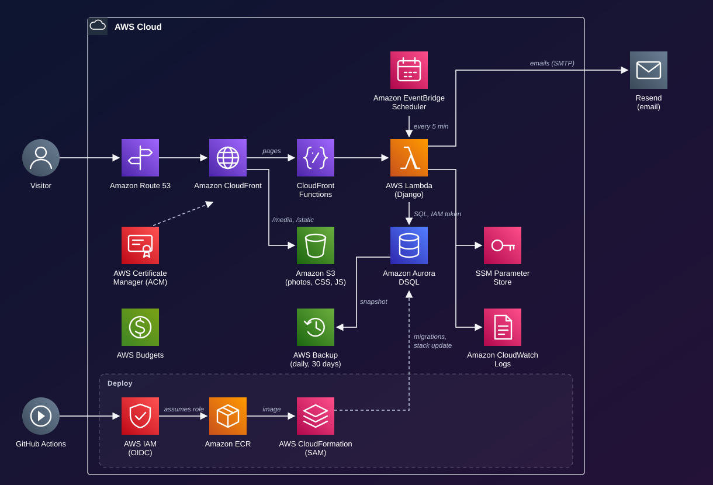

# Architecture

The store is a Django app running on AWS Lambda in São Paulo (sa-east-1), behind CloudFront, with photos on S3 and the database on Aurora DSQL. The whole infrastructure is code in this repository, and every merge to `main` deploys itself. Expected cost with little traffic: **about US$ 1 a month** (the Route 53 hosted zone plus cents of S3 and ECR).

## Path of a request

1. Route 53 resolves the domain to CloudFront, which serves HTTPS with the ACM certificate.
2. Before each request reaches Django, a CloudFront Function redirects `www`, and records the domain the visitor typed and their real IP.
3. Photos (`/media/*`) and static files (`/static/*`: CSS, JS, fonts) come from S3 and are cached at the edge. Static files are uploaded by the deploy, so a page never waits for a cold Lambda to deliver a stylesheet.
4. Everything else goes to the Lambda function URL with a secret header. Django rejects any request without it (`apps/core/middleware.py`).
5. Django reads its secrets from SSM when the instance starts, queries Aurora DSQL with a short-lived IAM token as the password, and answers. Logs go to CloudWatch.

## Deploy and backup

- GitHub Actions assumes an IAM role through OIDC: the credentials last minutes and no AWS key is stored on GitHub.
- On deploy it builds the image and pushes it to ECR, uploads the static files to S3, applies the migrations on Aurora DSQL and updates the `arcana-prod` stack through CloudFormation (AWS SAM).
- AWS Backup takes a snapshot of the database every day at 03:30 (São Paulo time) and keeps it for 30 days. Restoring creates a new cluster (see [deploy.md](deploy.md#8-backup-and-restore)).

## Services and costs

| Service | What it does for the store | Expected cost |
| --- | --- | --- |
| CloudFront | CDN in front of everything: HTTPS, caching of static files and photos, keeps the Lambda from being called directly | US$ 0 (1 TB and 10 M requests/month) |
| CloudFront Functions | Redirects www and forwards the domain and real IP to Django | US$ 0 (2 M/month) |
| Lambda | Runs Django with the Lambda Web Adapter, 1 GB of memory, with its own URL | US$ 0 (1 M requests/month) |
| Aurora DSQL | Serverless PostgreSQL-compatible database, billed per use, no password and no cold start | US$ 0 (100,000 DPUs and 1 GB/month) |
| AWS Backup | Daily database snapshot, kept for 30 days | cents |
| S3 | Product photos (old versions kept for 30 days) and the site's CSS, JS and fonts | cents |
| ECR | Lambda images; only the 3 most recent are kept | ~US$ 0.05 |
| SSM Parameter Store | Secrets: Django key, SMTP, CloudFront secret | US$ 0 |
| EventBridge Scheduler | Calls the Lambda every 5 minutes to keep it warm (and its database connection open) and every hour to cancel unpaid orders past the deadline | US$ 0 |
| CloudWatch Logs | Lambda logs, kept for 14 days | US$ 0 (5 GB/month) |
| IAM + OIDC | Role GitHub Actions assumes to deploy | US$ 0 |
| CloudFormation (SAM) | The whole infrastructure as code: `infra/template.yaml` and `infra/base.yaml` | US$ 0 |
| ACM | HTTPS certificate for the custom domain (in us-east-1) | US$ 0 |
| Route 53 | DNS for the custom domain | US$ 0.50/month |
| AWS Budgets | Email alert if the month's spending goes over US$ 1 | US$ 0 |
| **Outside AWS** | | |
| GitHub Actions | CI and deploy | US$ 0 (public repository) |
| Resend | Sign-up, login code and order emails | US$ 0 (free plan) |
| Registro.br | .com.br domain | ~R$ 40/year |

Free tiers as listed on the AWS pricing pages in November 2026.

## Aurora DSQL in the code

Aurora DSQL speaks the PostgreSQL protocol but is a distributed database with its own rules. What the project does about each one:

| DSQL behavior | How the project handles it |
| --- | --- |
| No password: connections use a short-lived IAM token | `aurora-dsql-django` signs a token per connection with the Lambda's role (`DSQL_ENDPOINT` in `config/settings.py`) |
| Optimistic concurrency: the second of two conflicting transactions fails at commit (SQLSTATE 40001) | Order and stock functions use `@atomico` (`apps/core/transacoes.py`), which runs the transaction again |
| No `unaccent` or `pg_trgm` extensions | Accent-insensitive search uses the normalized `Produto.busca` column; typo suggestions use `difflib` (`apps/core/texto.py`) |
| Indexes are built asynchronously (`CREATE INDEX ASYNC`), with no sort direction | Handled by the adapter; `config/dsql/` adds the async syntax for conditional unique indexes |
| A column's type can't be changed, and a column or a NOT NULL can't be dropped | Django's and allauth's migrations are rebuilt as one final-state migration in `config/migracoes/`; new fields must be additive |
| One DDL statement per transaction, at most 3,000 modified rows per transaction | Migrations run non-atomically on DSQL; bulk jobs must work in batches |
| `createcachetable` runs several DDL statements in one transaction | The cache table is a regular model (`apps.core.models.EntradaCache`) |

CI applies every migration through the DSQL engine against a scratch PostgreSQL and checks each statement with AWS's `dsql-lint` (`python manage.py ensaio_dsql`), so a migration DSQL can't run fails before it reaches `main`.
